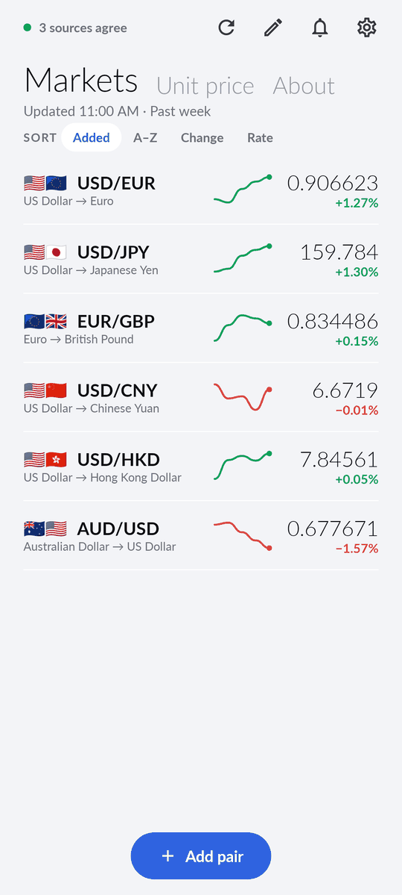
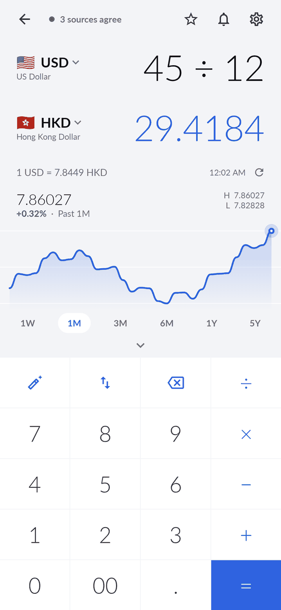
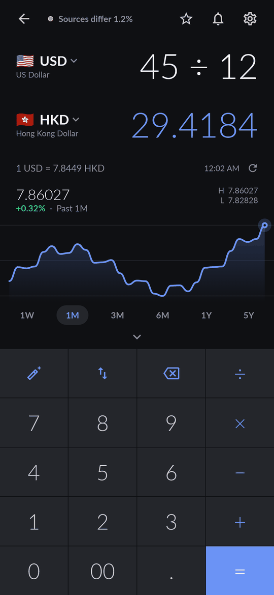
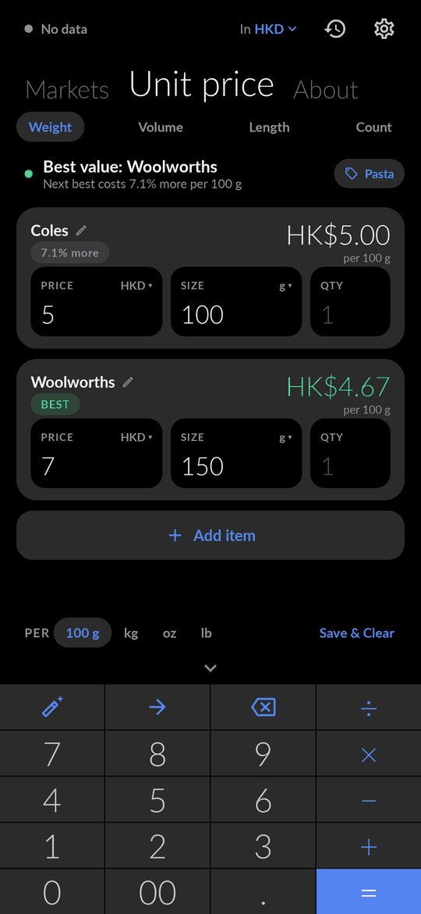
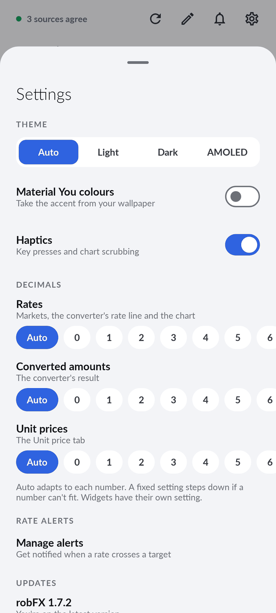
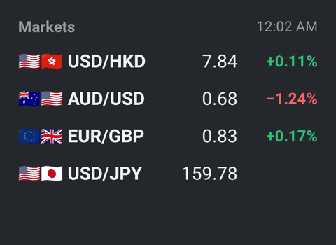
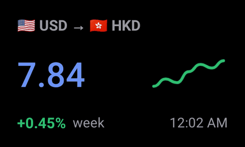
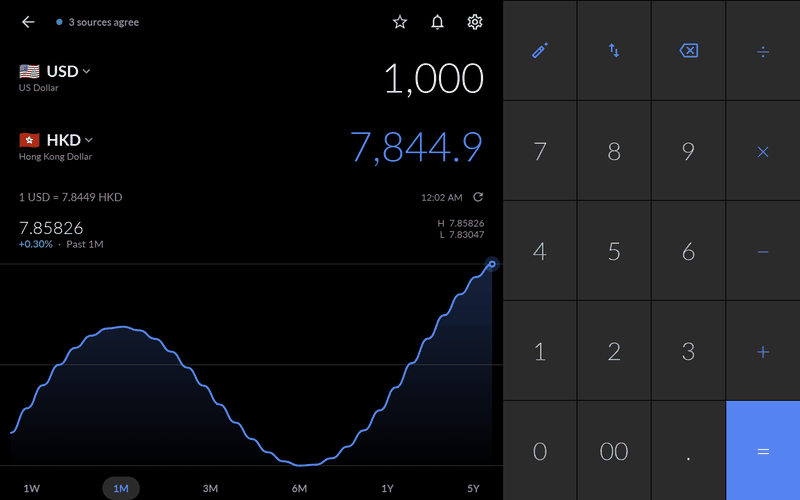

# robFX

Clean, sharp currency converter for Android (Compose, Material 3, compile and target SDK 37 / Android 17).

  
  
  
  
  

  
  

  

Screenshots are headless renders from the test suite (sample data, not live rates); regenerate with the command under Build.

- Rates: median of Frankfurter (ECB), fawazahmed0 currency-api, open.er-api.com, Coinbase, FloatRates and Wise (the last three intraday; Wise per pair in use), queried in parallel. Sources whose data is 18h+ behind the freshest are left out; the status pill warns when the rest differ >0.5%.
- Charts: Frankfurter time series, currency-api dated snapshots as fallback. Scrub by dragging.
- Unit price: compare shop items by price per 100 g / kg / lb / L / fl oz / m / each (weight, volume, length, count), with multipack quantities, prices in any currency converted to your home currency, recent comparisons, optional names for each item ("Coles", "Woolworths") so you can compare the same product across shops, and optional tags ("Pasta", "Milk") that are kept in history and filterable.
- Calculator keypad with + - × ÷, widget, background rate alerts (~30 min), Auto/Light/Dark/AMOLED + Material You.

Build: `ANDROID_HOME=... ./gradlew :app:assembleDebug`. Headless screenshots: `ROBOLECTRIC_DEPS=<dir with android-all jar> ./gradlew :app:testDebugUnitTest` writes `app/build/screens/`.

## Decimals

Settings -> Decimals sets the precision separately for rates (Markets, the converter's rate line, the chart), converted amounts and unit prices: Auto (the default, adaptive) or 0 to 6 places. A fixed setting steps down a decimal at a time if a number can't fit its space. Widgets have their own per-widget setting.

## Widgets

Three home-screen widgets, each instance configured on its own (the setup screen opens when you add one; on Android 12+ long-press a widget and choose Reconfigure):

- **Single pair**: one pair's rate, optionally for a custom amount, with change and a sparkline. Shrinks to a single row.
- **Watchlist**: follows the Markets screen (same order) or its own list of up to 8 pairs. Shows as many rows as fit; make it taller for more.
- **Quick convert**: a fixed amount converted into up to 6 currencies.

Per widget: decimal places (2 by default, 0 to 6 or Auto), theme (Black, Dark, Light, Auto, Material You), background transparency, flags, change, updated time, change period (day, week, month) and what a tap does (open that pair's converter, open Markets, or refresh). Widgets refresh on the shared 30-minute background schedule and whenever you leave the app.

## Diagnostics

Settings -> Diagnostics -> "Copy diagnostic report" copies the app version, device, screen and font size, why Android last ended the app (including the main-thread trace of an ANR when the system kept one), and any uncaught exception. Paste it into a bug report.

## Updates

robFX updates itself from this repo's GitHub releases.

- It checks on launch (at most every 3 hours) and in the background every 6 hours. Settings -> Updates shows the state and has a manual check.
- "Update automatically" (on by default) downloads a new version in the background. Android never allows a fully silent *first* install, so you confirm once; after that Android 12+ may apply updates without a prompt, otherwise a notification takes you to the system install dialog.
- On first use, Android asks you to allow robFX to install apps ("Install unknown apps"). Settings -> Updates -> Allow installs takes you there.
- The APK's SHA-256 is checked against the release when GitHub provides it, the file must be this app and a newer version, and Android itself refuses anything not signed with the same key.

## CI and releasing

- `.github/workflows/ci.yml` runs unit tests, lint and a debug build on every push and pull request.
- `.github/workflows/release.yml` builds the signed APK and publishes a GitHub release **automatically** when a new version lands on `main`. To ship a version:
  - bump `versionCode` and `versionName` in `app/build.gradle.kts`;
  - add a `## <version>` section to `changelog/CHANGELOG.md` (it becomes the release notes and the About tab's "What's new"; a test fails the build if it's missing);
  - push to `main`. A version that is already released is skipped.

  One-time setup:
  1. Add four repository secrets (Settings -> Secrets and variables -> Actions):
     `KEYSTORE_BASE64` (`base64 -w0 robfx.keystore`), `KEYSTORE_PASSWORD`, `KEY_ALIAS`, `KEY_PASSWORD`
     (the values are in your `keystore.properties`).
  2. It can also be run by hand: Actions -> Release -> Run workflow, or push a tag matching the version (e.g. `v1.7.0`).

  The job refuses to publish if the APK isn't signed with the key whose SHA-256 is pinned in the workflow, since phones that already have robFX would reject it.

## Rate freshness

Three of the six sources publish once a day, so the app records when each source's numbers were set, not just when they were downloaded. A source more than 18 hours behind the freshest is left out of the median; if even the freshest data is over 6 hours old while forex markets are open, the status pill reads "Delayed". The [Rate canary](.github/workflows/rates-canary.yml) workflow runs `tools/rates_canary.py` every 6 hours and fails (GitHub emails the owner) if a source breaks, goes stale or drifts more than 1% from the other live source.
